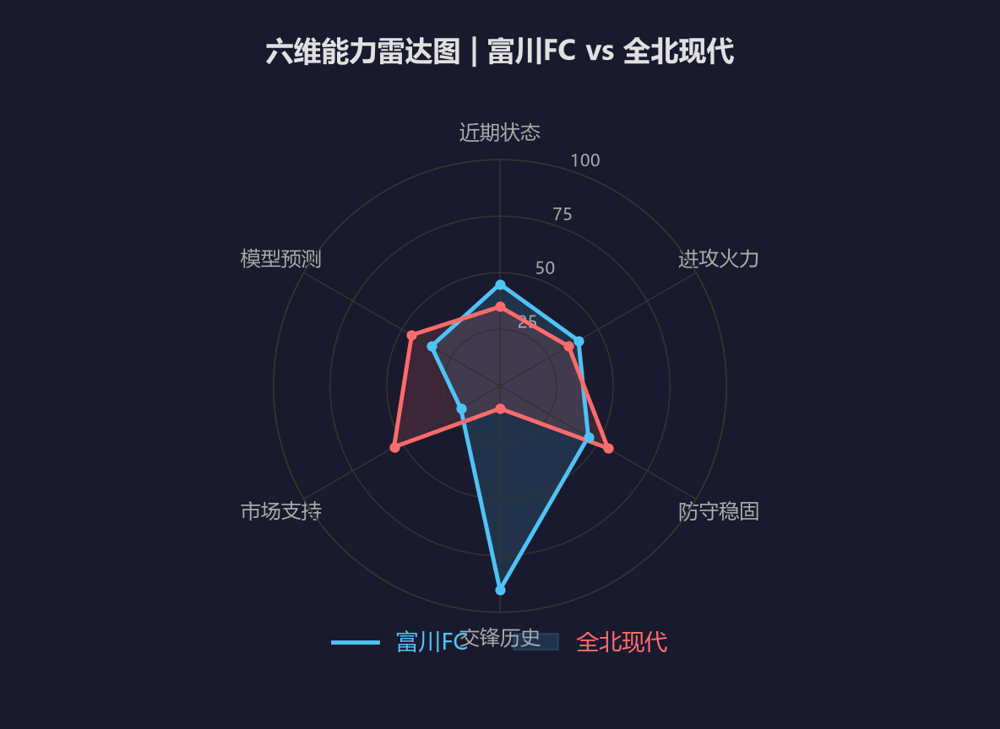
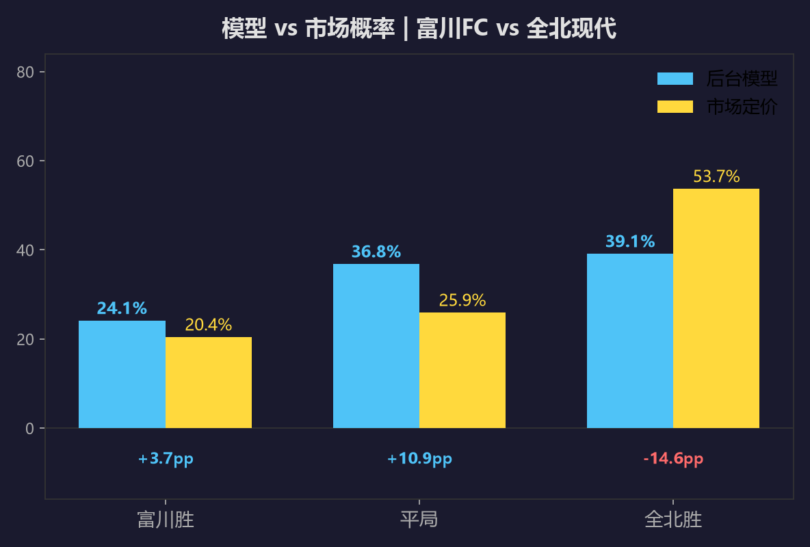
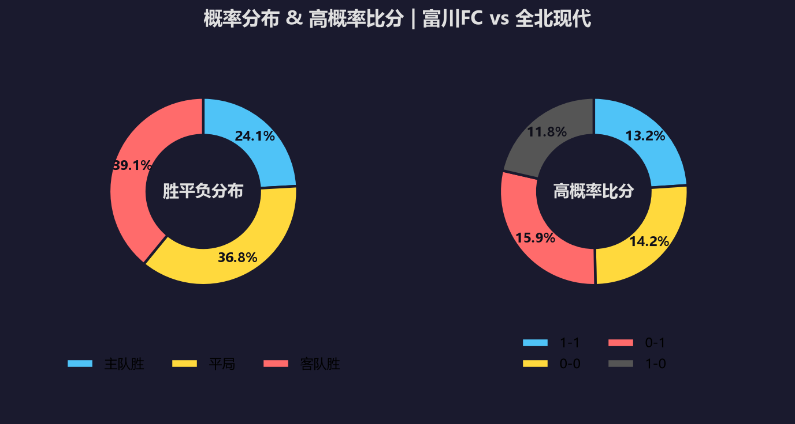
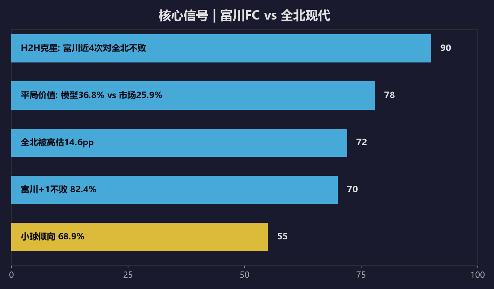
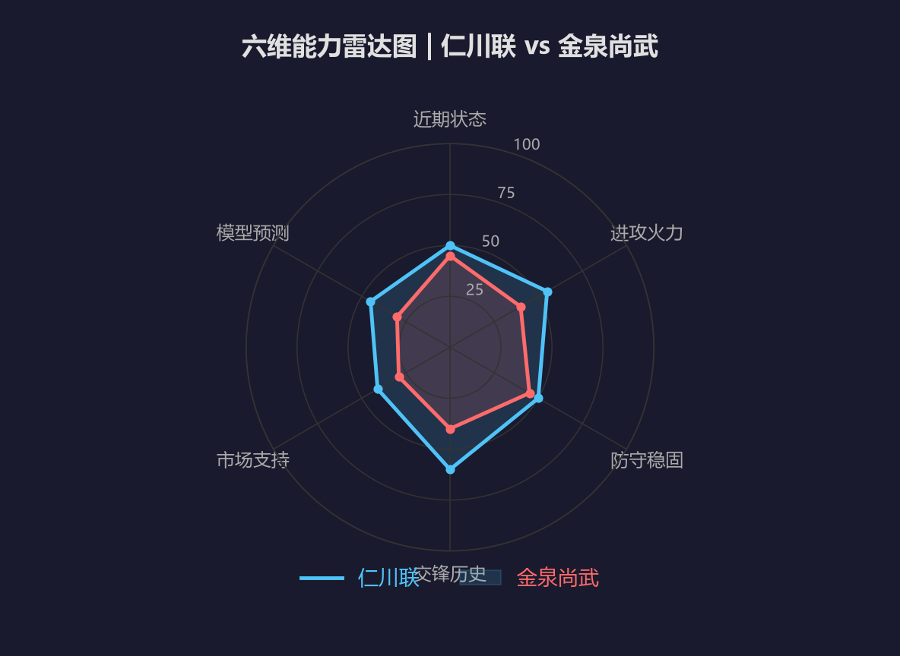
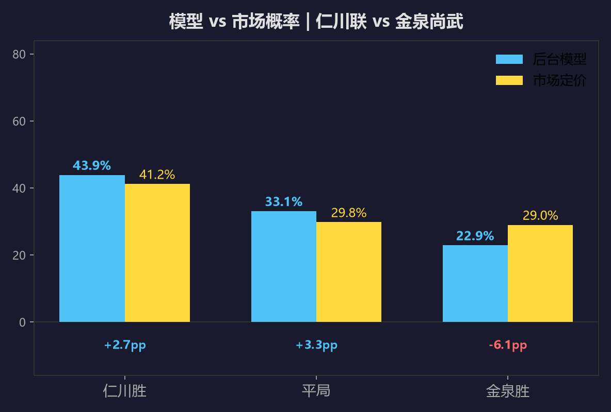
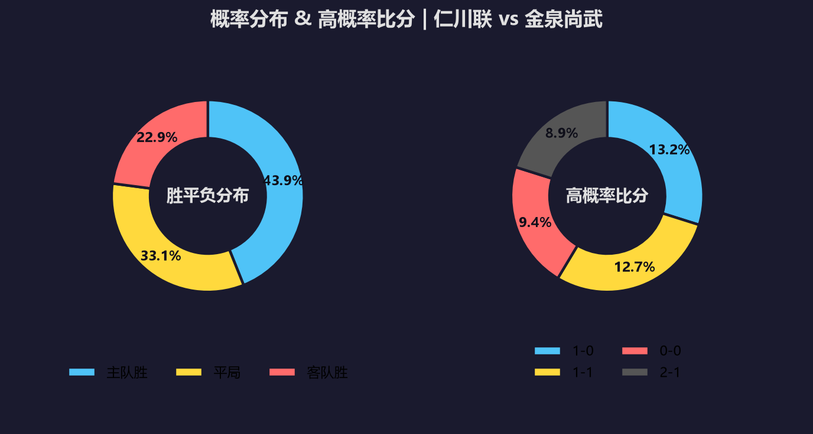
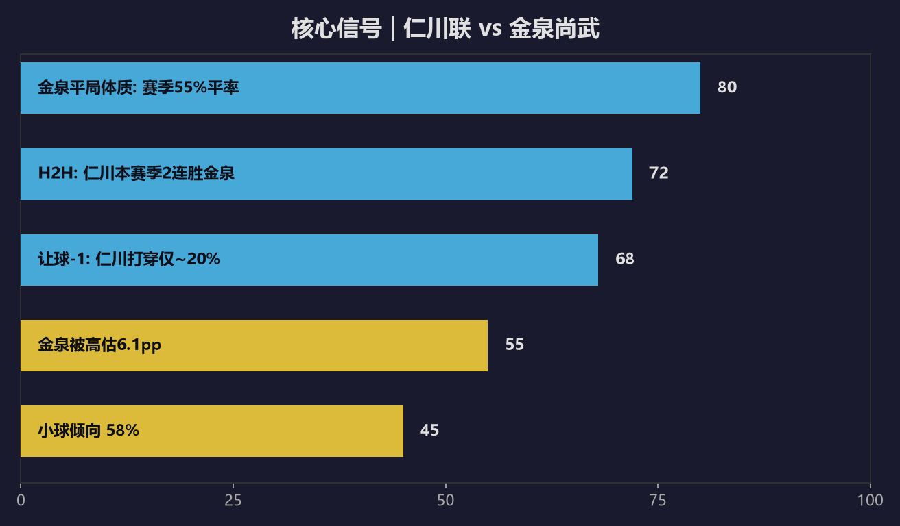

# 8月16日韩职两场：克星魔咒撞上平局大师

#韩职 #富川FC #全北现代 #仁川联 #金泉尚武 · 2026-08-16 18:30 · 第23轮

---

## 📋 两场速览

| 场次 | 对阵 | 模型方向 | 核心逻辑 |
|:----|:-----|:--------|:---------|
| 周日003 | 富川FC vs 全北现代 | 平局第一(36.8%) | 克星魔咒：全北近4次对富川0胜，被市场高估14.6pp |
| 周日004 | 仁川联 vs 金泉尚武 | 仁川微热(43.9%) | 平局大师金泉55%平率 vs 仁川H2H两连胜 |

两场都是18:30同时开球。一场有明确的定价偏差，一场定价基本打平——先说第一场，那才是真正值得看的。

---

## 【第一场】富川FC vs 全北现代 | 18:30 | 富川综合体育场

很多人一看全北现代排名第3、富川排第11，以为这场又是豪门客场收割。但拆开两队的交锋记录，全北近4次碰上富川一场没赢——2平2负。后台模型跑完10万次模拟：平局36.8%概率最高，全北胜39.1%，富川胜24.1%。市场那边把全北捧到53.7%，这中间差了14.6个百分点，是两场里最大的定价偏差。

### ⚔️ 战意

富川24分，离降级区不远，主场每一分都是救命稻草。全北34分还在争冠集团，客场作战没有松懈的理由。但要注意全北的状态：近10场只赢3场，近2轮1负1平（1-3济州、0-0首尔），场均进球跌到0.9个。豪门打弱旅，最怕的就是自己先哑火。

### 📊 两队数据对比

| 维度 | 富川FC | 全北现代 |
|:-----|:-------|:---------|
| 联赛排名 | 第11名（24分） | 第3名（34分） |
| 赛季战绩 | 5胜9平8负 | 9胜7平6负 |
| 主场/客场 | 主场1胜5平5负 | 客场4胜5平2负 |
| 近10场 | 3胜5平2负 | 3胜4平3负 |
| 场均进球 | 1.5个 | 0.9个 |
| 场均失球 | 1.0个 | 0.8个 |
| 交锋近4次 | 2胜2平0负 | 0胜2平2负 |
| 头号射手 | Jefferson 6球 | 李承佑 6球 |
| 伤停 | 暂无数据 | 暂无数据 |

### 🧮 后台模型：平局才是第一概率

模型给富川24.1%、平局36.8%、全北39.1%。市场的定价是全北53.7%——说白了，市场吃的就是全北这块招牌，模型看到的是全北4次对富川没赢过的里子。富川近10场50%平率，主场虽然只赢1场但平了5场，这个队就是打不死你也赢不了你的典型。

最可能的比分是0-1（15.9%），其次是0-0（14.2%）、1-1（13.2%）、1-0（11.8%）。平局相关的比分加起来概率不低——0-0加1-1就是27.4%。

| 比分 | 0-1 | 0-0 | 1-1 | 1-0 | 0-2 | 1-2 |
|:----|:---:|:---:|:---:|:---:|:---:|:---:|
| 概率 | 15.9% | 14.2% | 13.2% | 11.8% | 8.9% | 7.4% |

### 🌍 外媒对比

外媒这次基本都站全北。几个主流预测平台看好全北客场小胜，理由是排名差和身价差摆在那。但细看没人提到那4次交锋——全北上次赢富川要追溯到2016年。模型这边更看重交锋克星属性和全北的进攻荒，说白了，外媒看牌面，模型看历史，这场分歧就是价值所在。

### 💰 信号

最大的信号就是全北被高估14.6pp。市场给1.65的定价，等于把全北客胜当成接近六成的事——但全北近10场场均0.9球，客场胜率36.4%，哪来的底气？就像三国里那些看起来兵多将广的，真打起来不一定赢。让球设置那边富川+1胜45.4%，模型算出来82.4%不败概率，这俩玩法自己都在打架。

### ⚽ 大小球

模型大2.5球只有31.1%，小2.5球68.9%。市场TTG定价也偏小，2球最热。双方进攻端都不算利索——富川主场场均1.5个进球但全北客场只失0.55个，这场更可能闷着踢。

### 🎯 推荐比分（三档）

| 维度 | 比分 | 概率 | 逻辑 |
|:----|:----|:----:|:-----|
| 首选 | 1-1 / 0-0 | 13.2% / 14.2% | 平局第一概率路径，双方都进不了球 |
| 次选 | 0-1 | 15.9% | 全北打破克星魔咒小胜 |
| 防范 | 1-0 | 11.8% | 富川爆冷路径，主场保级战意 |

---

## 【第二场】仁川联 vs 金泉尚武 | 18:30 | 仁川文鹤竞技场

这场跟第一场正好反过来——市场定价和模型几乎重合，没有明显的便宜可捡。仁川联第8（29分）主场迎战第10的金泉尚武（24分）。仁川主胜41.2%、平局29.8%、金泉29.0%，模型算出来43.9%、33.1%、22.9%，最大差距也就6个百分点，属于正常波动。

### ⚔️ 战意

仁川29分想冲上半区，主场作战自然想拿分。金泉24分中游偏下，客场拿1分也能接受。两队都没有生死压力，但仁川近4轮2胜（2-1蔚山、1-0全北），状态在线；金泉近5轮3胜2平不败，也不是软柿子。这场更像是双方都想赢但谁也吃不掉谁的局。

### 📊 两队数据对比

| 维度 | 仁川联 | 金泉尚武 |
|:-----|:-------|:---------|
| 联赛排名 | 第8名（29分） | 第10名（24分） |
| 赛季战绩 | 8胜5平8负 | 4胜12平6负 |
| 主场/客场 | 主场4胜1平6负 | 客场3胜5平3负 |
| 近10场 | 4胜2平4负 | 3胜5平2负 |
| 场均进球 | 1.4个 | 1.1个 |
| 场均失球 | 0.9个 | 1.1个 |
| 交锋近10次 | 4胜3平3负 | 3胜3平4负 |
| 头号射手 | Mugoša 8球 | 高在贤 6球 |
| 伤停 | 暂无数据 | 暂无数据 |

### 🧮 后台模型：仁川微热，金泉平局体质是变量

模型给仁川43.9%、平局33.1%、金泉22.9%。金泉这个队吧，你说他强也不强，说弱也不弱，就是平。一直平。赛季22场平了12场，55%的平率是K联赛第一。但反过来，仁川主场11场只平1场，主场非胜即负——这两个数据撞在一起，平局到底站不站得住，就是这场最大的悬念。

最可能的比分是1-0（13.2%），其次是1-1（12.7%）、0-0（9.4%）、2-1（8.9%）。

| 比分 | 1-0 | 1-1 | 0-0 | 2-1 | 0-1 | 2-0 |
|:----|:---:|:---:|:---:|:---:|:---:|:---:|
| 概率 | 13.2% | 12.7% | 9.4% | 8.9% | 9.1% | 9.2% |

### 🌍 外媒对比

外媒对这场分歧明显。有的按排名看好仁川主场，有的点名金泉的平局体质说1-1打底。两家AI预测平台一个给仁川55%一个给49%，差值不大，基本都认可仁川略占优但赢面有限。说白了，这场没人敢打包票，外媒共识就是"仁川微热"。

### 💰 信号

信号很干净：金泉被市场轻微高估6.1pp，让球-1那边仁川赢2球的概率模型给22.7%、市场给18.3%，两边一致认为仁川大胜很难。真要找一个价值点，平局3.3pp的微弱优势聊胜于无——但这场本质上没有第一场那种一眼能看出来的便宜。

### ⚽ 大小球

模型大2.5球42%，市场TTG也偏小，2球3.30定价最热。金泉客场场均1.09球、失1.09球，仁川主场场均1.09球，这组数字放一起，指望大球不太现实。

### 🎯 推荐比分（三档）

| 维度 | 比分 | 概率 | 逻辑 |
|:----|:----|:----:|:-----|
| 首选 | 1-0 | 13.2% | 仁川H2H两连胜+双锋状态在线 |
| 次选 | 1-1 | 12.7% | 金泉平局体质路径 |
| 防范 | 0-1 | 9.1% | 金泉近5轮3胜2平，客场偷分 |

---

## 🏁 赛博模型复盘总结

| 场次 | 方向倾向 | 高概率比分 | 进球趋势 |
|:----|:--------|:----------|:---------|
| 富川FC vs 全北现代 | 平局第一(36.8%) | 1-1 / 0-0 / 0-1 | 小球(大2.5仅31%) |
| 仁川联 vs 金泉尚武 | 仁川微热(43.9%) | 1-0 / 1-1 / 0-0 | 小球(大2.5仅42%) |

两场一句话：第一场全北被市场高估，克星魔咒加进攻荒，平局和富川不败都有价值；第二场定价干净，仁川微热但金泉平局体质随时搅局。真要选一场，第一场的信号比第二场清晰得多。

富川这个队吧，主场能赢蔚山，也能0-3输给升班马，就是起伏大。全北4次没赢过它，真要指望客场稳赢？反正我是信了这场有冷。

## 💬 互动

全北4次碰上富川一场没赢，这场能打破魔咒吗？评论区留个比分，赛后回来验证。

---

*以上分析基于公开数据和个人模型推演，仅供参考。足球是圆的，场上什么事都可能发生。理性看球，享受比赛。*

*数据来源：懂球帝、ESPN、各队官网*
